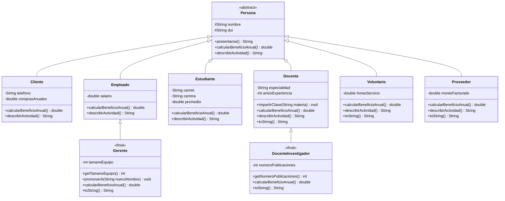

# Diagrama de clases del proyecto (Semana 7)

Notación UML: `#` = protected, `-` = private, `+` = public. El triángulo vacío (`<|--`) representa la relación "es un".

Elementos abstractos: la clase *Persona* lleva la etiqueta `<<abstract>>` y sus métodos abstractos (*calcularBeneficioAnual()* y *describirActividad()*) se dibujan en cursiva. Las clases `Gerente` y `DocenteInvestigador` llevan la etiqueta `<<final>>`: no admiten subclases. Además, `presentarse()` está declarado `final` en `Persona`: ninguna subclase puede reemplazarlo.

Novedad de esta semana: aparecen dos clases de **tercer nivel**, `Gerente` (que extiende de `Empleado`) y `DocenteInvestigador` (que extiende de `Docente`).

## Resumen de la jerarquía

| Nivel | Clase | Es un... | Atributos propios |
|---|---|---|---|
| 1 | *Persona* (abstracta) | (raíz) | `#nombre`, `#dui` |
| 2 | `Cliente` | `Persona` | `telefono`, `comprasAnuales` |
| 2 | `Empleado` | `Persona` | `salario` |
| 2 | `Estudiante` | `Persona` | `carnet`, `carrera`, `promedio` |
| 2 | `Docente` | `Persona` | `especialidad`, `aniosExperiencia` |
| 2 | `Voluntario` | `Persona` | `horasServicio` |
| 2 | `Proveedor` | `Persona` | `montoFacturado` |
| 3 | `Gerente` (final) | `Empleado` | `tamanoEquipo` |
| 3 | `DocenteInvestigador` (final) | `Docente` | `numeroPublicaciones` |

